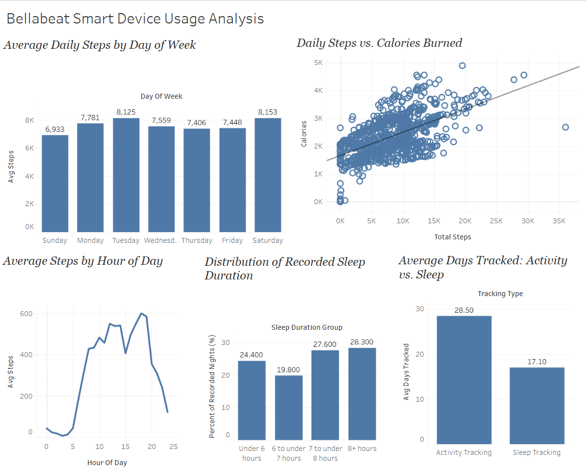

# Bellabeat Smart Device Usage Analysis

## Google Data Analytics Capstone Project

This project analyzes Fitbit smart-device activity and sleep data to identify consumer behavior trends and develop data-driven marketing recommendations for Bellabeat, a wellness technology company.

The analysis follows the Google Data Analytics process:

**Ask → Prepare → Process → Analyze → Share → Act**

### Tools Used

- **Google BigQuery / SQL** — data cleaning, transformation, joins, aggregation, and analysis
- **Tableau Public** — data visualization and dashboard creation
- **GitHub** — project documentation and portfolio presentation

---

## Ask

### Business Task

Bellabeat wants to better understand how consumers use smart fitness devices so that the company can identify behavioral trends and apply those insights to its marketing strategy.

The analysis focuses on three main questions:

1. What trends exist in smart-device usage?
2. How could these trends apply to Bellabeat customers?
3. How could these trends influence Bellabeat's marketing strategy?

### Stakeholders

Key stakeholders include:

- Bellabeat cofounder and Chief Creative Officer Urška Sršen
- Bellabeat cofounder Sando Mur
- Bellabeat marketing analytics team
- Bellabeat marketing and executive leadership

---

## Prepare

The project uses publicly available **Fitbit Fitness Tracker Data** containing activity and sleep information from Fitbit users.

Four datasets were selected for the analysis:

| Dataset | Records | Users | Purpose |
|---|---:|---:|---|
| Daily Activity | 940 | 33 | Daily steps, activity, sedentary time, and calories |
| Sleep Day | 413 before cleaning | 24 | Sleep duration and time in bed |
| Hourly Steps | 22,099 | 33 | Hourly movement patterns |
| Hourly Intensity | 22,099 | 33 | Hourly activity intensity |

The data covers approximately one month, from **April 12 to May 12, 2016**.

### Data Limitations

The dataset has several limitations:

- Small sample size of 33 activity users
- Only 24 users recorded sleep data
- Approximately one month of observations
- No demographic information such as age, gender, or location
- Data was collected in 2016
- Fitbit users are not necessarily representative of Bellabeat customers

The findings should therefore be treated as exploratory insights rather than conclusions that represent all wearable-device users.

---

## Process

The datasets were imported into Google BigQuery and checked for data-quality issues.

The cleaning process included:

- Verifying row counts and unique users
- Checking for duplicate user-date and user-hour records
- Checking for missing values
- Converting date and datetime fields into usable SQL formats
- Removing three duplicate sleep records
- Creating separate cleaned tables while preserving the raw data
- Validating the cleaned tables before beginning analysis

No missing values were found in the primary fields used for analysis.

After duplicate removal, the sleep dataset contained **410 unique records**.

The complete cleaning and validation SQL can be found in:

[`sql/data_cleaning.sql`](sql/data_cleaning.sql)

---

## Analyze

SQL was used to examine daily activity, sleep behavior, hourly movement patterns, device usage consistency, and relationships between variables.

### Key Findings

#### 1. Average Daily Activity

Across 940 recorded user-days:

- **7,638 average daily steps**
- **2,304 average daily calories**
- **21.2 very active minutes**
- **13.6 fairly active minutes**
- **192.8 lightly active minutes**

Most recorded active time came from light activity rather than moderate or high-intensity activity.

#### 2. Activity Varied by Day of Week

Average daily steps were highest on:

- **Saturday — 8,153 steps**
- **Tuesday — 8,125 steps**

Sunday had the lowest average:

- **Sunday — 6,933 steps**

This suggests that activity patterns vary throughout the week rather than following a simple weekday-versus-weekend pattern.

#### 3. Steps and Calories Were Positively Related

Daily steps and calories burned showed a moderate positive correlation:

**r = 0.592**

Days with more steps generally tended to be associated with greater calorie expenditure.

#### 4. Average Sleep Was About Seven Hours

Users averaged:

- **6.99 hours asleep**
- **7.64 hours in bed**
- **91.6% average sleep efficiency**

However, sleep duration varied considerably across recorded nights.

#### 5. Many Recorded Nights Contained Less Than Seven Hours of Sleep

Of the 410 recorded sleep nights:

- **24.4%** were under 6 hours
- **19.8%** were between 6 and under 7 hours
- **27.6%** were between 7 and under 8 hours
- **28.3%** were 8 hours or more

Approximately **44.2% of recorded nights contained fewer than seven hours of sleep**.

#### 6. Activity Peaked in the Late Afternoon and Evening

The highest average hourly step count occurred around:

**6 PM — approximately 599 steps per hour**

Other highly active periods occurred around 5 PM, 7 PM, noon, and early afternoon.

Overall, activity increased throughout the day and was strongest during the late afternoon and early evening.

#### 7. Activity Tracking Was More Consistent Than Sleep Tracking

Activity was recorded for an average of:

**28.5 days**

Sleep was recorded for an average of:

**17.1 days among users with sleep data**

Additionally:

- 21 of 33 users recorded activity for all 31 days
- Only 3 of 24 sleep users recorded sleep for all 31 days

This suggests that daytime activity tracking was substantially more consistent than sleep tracking.

---

## Share

A Tableau dashboard was created to communicate the major findings.

The dashboard includes:

- Average Daily Steps by Day of Week
- Daily Steps vs. Calories Burned
- Average Steps by Hour of Day
- Distribution of Recorded Sleep Duration
- Average Days Tracked: Activity vs. Sleep

### Tableau Dashboard

**[View the Bellabeat Smart Device Usage Analysis Dashboard](https://public.tableau.com/views/BellabeatSmartDeviceUsageAnalysis_17929178157150/Dashboard1?:language=en-US&:sid=&:redirect=auth&:display_count=n&:origin=viz_share_link)**

### Dashboard Preview



---

## Act

Based on the analysis, three recommendations were developed for Bellabeat.

### 1. Strengthen Sleep-Tracking Engagement

Activity tracking was substantially more consistent than sleep tracking.

Bellabeat could encourage more regular sleep tracking through:

- bedtime reminders
- sleep-tracking streaks
- personalized sleep summaries
- educational content explaining the value of consistent sleep data

Increasing sleep engagement could help users receive more complete wellness insights from Bellabeat products.

### 2. Time Activity Messaging Around Relevant Periods

Users were most active during the late afternoon and early evening, particularly around 5–7 PM.

Bellabeat could test:

- activity reminders
- motivational notifications
- daily movement challenges
- personalized activity prompts

around periods when users are already more likely to engage in physical activity.

Bellabeat could also test reminders during lower-activity periods to determine whether targeted messaging increases movement.

### 3. Personalize Activity Goals

Users demonstrated substantial differences in average daily activity.

Instead of relying on one universal step target, Bellabeat could create personalized goals based on each user's recent behavior.

Personalized recommendations could include:

- gradual step increases
- individual progress targets
- activity streaks
- personalized movement reminders
- adaptive wellness goals

This could make activity recommendations more achievable and relevant for users with different activity levels.

---

## Conclusion

The analysis suggests that wearable-device users consistently engage with activity tracking but are less consistent with sleep tracking. Activity also varies by time of day, day of week, and individual behavior.

Bellabeat could use these patterns to create more personalized, timely, and habit-focused experiences that encourage users to engage more consistently with both activity and sleep features.

Because the dataset is small, older, and lacks demographic information, additional Bellabeat customer data would be needed before making large-scale business decisions.

---

## Repository Structure

```text
bellabeat-data-analysis/
│
├── README.md
│
├── sql/
│   ├── data_cleaning.sql
│   └── data_analysis.sql
│
├── tableau/
│   └── dashboard-link.md
│
└── images/
    └── bellabeat_dashboard.png
```

## SQL Files

- [`data_cleaning.sql`](sql/data_cleaning.sql) — data validation, duplicate checks, date/time transformations, and creation of cleaned tables
- [`data_analysis.sql`](sql/data_analysis.sql) — activity, sleep, correlation, tracking consistency, and hourly behavior analysis

---

## Author

**Siva Rajesh**

Google Data Analytics Professional Certificate Capstone Project
